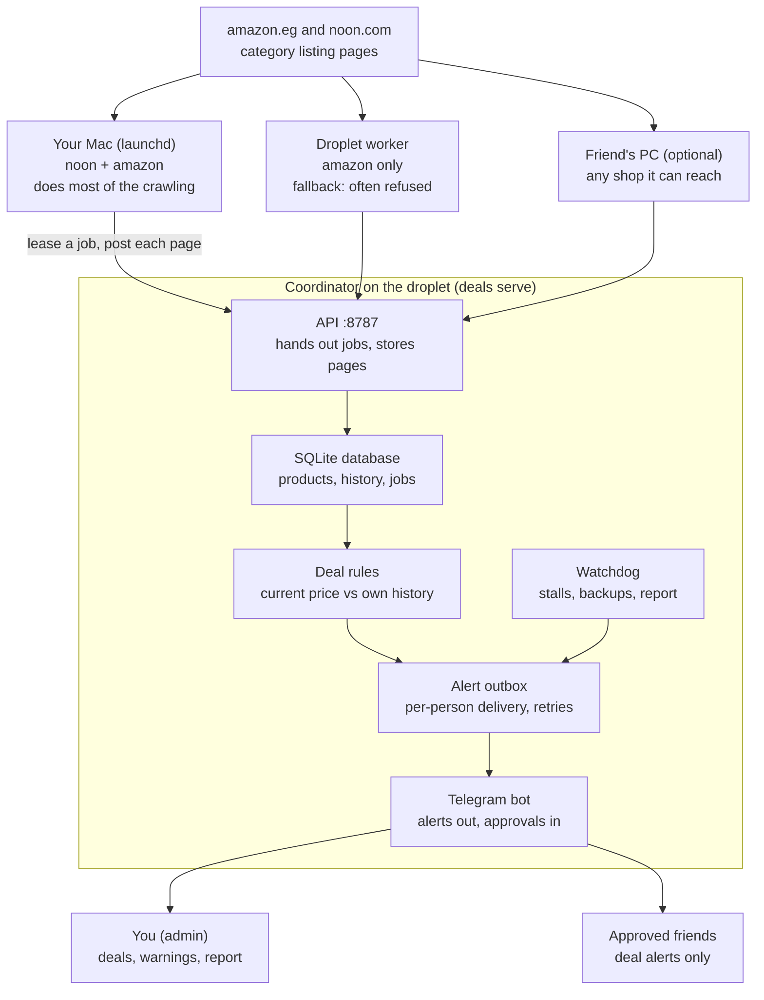
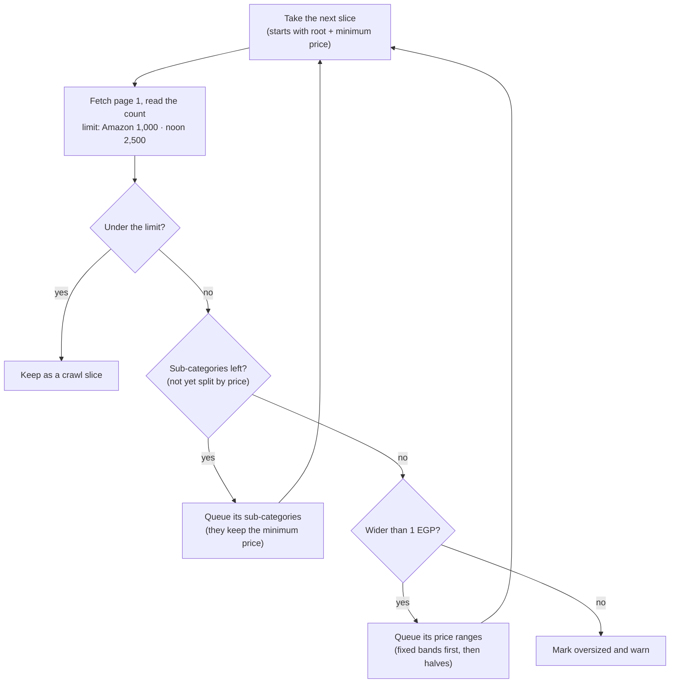
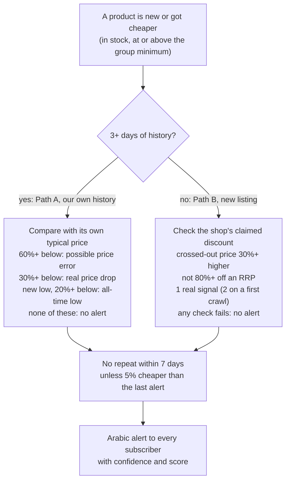

# Deals price tracker: complete guide

Also kept as a shared doc with the same content. Companion docs: [MONITORING.md](MONITORING.md)
(health, devices, logs, runbook), [INTERNALS.md](INTERNALS.md) (code-level detail),
[REVIEW-2026-10-25.md](REVIEW-2026-10-25.md) (first review of the live system), [ROADMAP.md](ROADMAP.md).

## Overview

The system crawls whole categories on amazon.eg and noon.com (Egypt), stores every product's price
history, and sends an Arabic Telegram alert when a price is genuinely low compared with that product's
own history. It tracks about 43,000 products in 12 groups: TVs, refrigerators, air conditioners, phones,
laptops, desktops, monitors, PC components, headphones, kitchen machines (fryers, coffee machines,
blenders, microwaves), other kitchen appliances, and cooking and dishwashers.

It has four parts. One coordinator owns the data and decides what to do; any number of workers do the
crawling from their own internet connections.

| Part | Runs on | What it does |
| --- | --- | --- |
| Coordinator (`deals serve`) | Droplet 207.154.206.127 | Owns the SQLite database, hands out crawl jobs, stores results, detects deals, runs the Telegram bot, watches for problems, takes daily backups |
| Worker (`deals worker`) | Your Mac, the droplet, any friend's PC | Asks for a job, downloads the shop pages, sends the products back. Holds no database |
| Site adapters (`sites/amazon_eg.py`, `sites/noon_eg.py`) | Inside each worker | Know how to fetch and read one listing page of each shop |
| Telegram bot (@Jerrys_deals_bot) | Inside the coordinator | Sends deal alerts to approved subscribers and system warnings to you |

Workers only make outgoing requests to the coordinator, so nothing needs to be opened on your Mac or on a
friend's router. Your Mac does the real crawling because both shops refuse most datacenter traffic; the
droplet's worker is a fallback for Amazon.



Pages flow down from the shops through the workers; only the coordinator writes the database and talks to
Telegram.

## Connecting to the server

You log in with `ssh root@207.154.206.127` from your Mac, using the key `~/.ssh/id_ed25519` (fingerprint
`a8:65:ea:af:...:7f:62`, named "jerry" in DigitalOcean).

1. Load the key once per Mac login, because it has a passphrase: `ssh-add --apple-use-keychain ~/.ssh/id_ed25519`.
   With `--apple-use-keychain` macOS remembers the passphrase after reboots.
2. Log in: `ssh root@207.154.206.127`. If it says "Permission denied (publickey)", step 1 was skipped.
3. Leave with `exit`.

What lives where on the server:

| Path | What it is |
| --- | --- |
| `/opt/deals` | The code (copied there by `make deploy`) and its Python environment `.venv` |
| `/etc/deals/config.toml` | Settings: watched categories, alert rules, worker tokens, Telegram token. Never commit it |
| `/etc/deals/worker.env` | The droplet worker's token and sites |
| `/var/lib/deals/deals.db` | The database (the only real copy of all data) |
| `/var/lib/deals/backups/` | Daily compressed backups, last 7 kept |
| `/opt/ms-playwright` | Headless Chromium, used to pass Amazon's bot check |

Two systemd services run everything and restart automatically after a crash or reboot:

| Service | Command it runs |
| --- | --- |
| `deals-coordinator` | `deals serve` on port 8787: API, database, Telegram bot, watchdog |
| `deals-worker` | `deals worker` for amazon_eg only |

Useful commands once logged in:

- Status: `systemctl status deals-coordinator deals-worker`
- Live logs: `journalctl -u deals-coordinator -u deals-worker -f` (or `make logs` from your Mac)
- Restart after editing the config: `systemctl restart deals-coordinator`
- Run any `deals` command as the service user:
  `runuser -u deals -- /opt/deals/.venv/bin/deals status --config /etc/deals/config.toml`

The firewall (ufw) only allows SSH and port 8787. Port 8787 accepts workers that present a token from
`[workers]` in the config.

## Connecting to the database

The only real database is the SQLite file `/var/lib/deals/deals.db` on the server; your Mac has no
database of its own. SQLite is a file, not a network server, so IntelliJ cannot connect to it live. Use
one of three ways, all run from the project folder on your Mac:

| Command | What you get | Live? |
| --- | --- | --- |
| `make dbweb` | The database in your browser at http://localhost:8001 (Datasette): tables, filters, a SQL box, and the ready-made queries as clickable pages. Runs through an SSH tunnel, nothing exposed. Ctrl+C stops it | Yes, read-only |
| `make sql` | A SQL prompt on the server: `.tables`, `.schema products`, any `SELECT ...;`, `.quit` to leave | Yes, read-only (writes are refused) |
| `make db` | Downloads a consistent copy to `data/server.db` for IntelliJ | No, a snapshot; run again to refresh |

Setting up IntelliJ (one time, after `make db`):

1. View, Tool Windows, Database.
2. Click +, Data Source, SQLite.
3. Name it "deals (server)" and pick the file `data/server.db` in the project folder. Click "Download
   missing driver files" if offered.
4. Test Connection, then OK.
5. To refresh later: run `make db`, then click Refresh in the Database window (Disconnect first if old
   data still shows).

The tables (full column list in [INTERNALS.md](INTERNALS.md)):

| Table | One row per | Main columns |
| --- | --- | --- |
| `products` | Product (noon: product and seller) | site, sku, title, url, price, list_price, list_price_kind, in_stock, stock_left, badges, rating, reviews, seller, grp, first_seen_at, last_seen_at |
| `price_history` | Price or stock change | product_id, price, list_price, in_stock, observed_at |
| `jobs` | Category root to plan, or slice to crawl | kind, site, target, grp, interval_s, next_due_at, lease_*, failures, last_error, last_done_at |
| `alerts` | Deal alert or system message | product_id, kind, price, reference_price, drop_pct, score, message, created_at |
| `deliveries` | Alert sent to one person | alert_id, chat_id, sent_at, attempts, error |
| `subscribers` | Telegram user | chat_id, name, status, is_admin, approved_at |
| `workers` | Crawling machine | name, last_seen_at, last_ip, sites, pages, jobs_done |
| `worker_sites` | Machine and shop | last_ok_at, last_error_at, last_error, pages, products, blocks |
| `blocks` | Shop that blocked an IP | site, ip, strikes, until, reason |
| `events` | Log line from a device or the coordinator | at, source, level, message |

Three conventions to remember when reading the data:

- Prices are whole numbers in piastres: divide by 100 for EGP (`1999900` = 19,999 EGP).
- Times are UTC text such as `2026-10-25T21:05:00+00:00`. Cairo is UTC+3 until 29 October 2026, then UTC+2.
- noon skus look like `N70091992V@startup`: the product code plus the seller.

Ready-made queries live in `docs/queries.sql` (open it in IntelliJ, put the cursor in a query, Cmd+Enter):
overview, products per group, what is crawling now, latest price changes, biggest drops, alerts, scarce
products on a deal, one product's full history, find a product by name.

## Running the code

Everything is driven by `make` from the project folder `~/IdeaProjects/e-commerce-discounts-alert` on your
Mac. The production system already runs; these are the commands to check it, change it and ship changes.

| Command | What it does |
| --- | --- |
| `make health` | Checks everything (server services and logs, deployed code, Mac worker, database, crawling per site, Telegram, disk, backups) and prints a pass, warning or failure line for each |
| `make devices` / `make dashboard` | Every device and its fetch state per shop (terminal / browser) |
| `make events` | Live logs from all devices and the server |
| `make status` | Workers, blocked IPs, backlog per site, freshness per group |
| `make alerts` / `make movers` | Deal alerts and biggest price moves of the last 24 hours |
| `make report` | Sends the daily report to your Telegram now (it also arrives at 09:00 Cairo time) |
| `make logs` | Follows the server's systemd logs live |
| `make test` | Runs the automated tests |
| `make deploy` | Tests, copies the code to the server, installs, restarts both services, checks they answer |
| `make telegram TOKEN=...` | Connects a Telegram bot (already done) |

First-time setup on a new Mac:

1. `python3 -m venv .venv` then `.venv/bin/pip install -e ".[dev]"`.
2. `.venv/bin/python -m playwright install chromium` (needed to pass Amazon's bot check).
3. `make mac-worker-env` writes `worker.env` with this Mac's token from the server.
4. `make install-mac-worker` runs the worker in the background: it starts at login and restarts if it
   crashes. Its log is `~/Library/Logs/deals-worker.log`; `make uninstall-mac-worker` removes it.

Shipping a change: edit the code, run `make test`, then `make deploy`, then `make health`. If you changed
worker code, also restart the Mac worker: `launchctl kickstart -k gui/$(id -u)/com.deals.worker`.

Changing what is tracked: edit `[[watch]]` groups in `/etc/deals/config.toml` on the server, then
`systemctl restart deals-coordinator`. New groups are planned within a minute; removed ones are dropped.
Category ids come from `deals categories amazon_eg 18018102031` or `deals categories noon_eg electronics-and-mobiles`.

Adding a friend's computer as a worker (more crawling capacity from another connection):

1. On the server, create a token with `deals token`, add it under `[workers]` as `ahmed = "..."`, restart
   the coordinator.
2. On their computer: clone the repo, do setup steps 1 and 2, then run
   `DEALS_COORDINATOR=http://207.154.206.127:8787 DEALS_TOKEN=... DEALS_SITES=noon_eg,amazon_eg .venv/bin/deals worker`.

Running everything on one machine without the server (for experiments): `cp config.example.toml config.toml`,
then `.venv/bin/deals local` starts a coordinator and a worker in one process with a local database.

## Algorithm 1: fetching the shops

Each shop has an adapter with one job: given a slice (a category, optionally with a price range) and a page
number, return the products on that page, the total count, and the sub-categories. Neither adapter opens
product pages; everything comes from listing pages, which hold 24 to 50 products per request.

**amazon.eg.** Amazon sits behind an AWS WAF JavaScript challenge, so a plain request gets a 202 or 503
"automated access" page.

1. The first time, the worker opens headless Chromium on the Amazon homepage and waits until the challenge
   page disappears (up to 30 seconds).
2. It saves the browser's cookies to `data/amazon_eg_cookies.json`.
3. Every page after that is a plain HTTP request with those cookies, sent by `curl_cffi`, which copies
   Chrome's network fingerprint. That takes about 1 second per page.
4. If a response is the challenge again, it solves the challenge once more. If that also fails, the worker
   reports the job as blocked.

Category pages are fetched as `/-/en/s?rh=n:<category id>,p_36:<min>-<max>`. The `/-/en/` part forces
English titles, and `p_36` is a price range in piastres. A price filter is always sent, even `0-`, because a
bare category page uses a "landing" layout with no product grid.

**noon.com.** noon's web pages have a bot challenge too, but the JSON API its own website uses
(`/_svc/catalog/api/v3/u/egypt-en/<category path>/?page=N&f[price][min]=...`) answers plain requests with
50 structured products each time. An unknown category path silently returns a different category, so the
adapter checks the breadcrumb and fails loudly on a typo.

**Which machine can reach which shop** (tested 25 October 2026):

| Shop | Home IP (your Mac) | Droplet (DigitalOcean Frankfurt) |
| --- | --- | --- |
| amazon.eg | Works | Varies: category pages were refused about 5 times in 6 in one test, fine in others |
| noon.com | Works | Always refused (Akamai 403) |

**What is read from each product card** (no extra requests):

| Signal | amazon.eg | noon |
| --- | --- | --- |
| Price | The featured offer's price | The offer's sale price, else its price |
| Crossed-out price | "Was:" (Amazon's own recent price, trusted) or "List:" (brand RRP, often inflated) | Seller-set, treated like an RRP |
| Stock left | "Only 3 left in stock" | "Only 3 left" |
| Deal badge | "Limited time deal" | "Deal", "Mega Deal" |
| Shop's own price history | none | "Lowest price in 30 days", "in a year" |
| Demand | "300+ bought in past month" | "200+ sold recently", "Selling out fast", bestseller |
| Rating | Stars and review count | Stars and review count |
| Seller | not shown | Store name |

**noon sellers.** One noon product can be sold by several sellers at very different prices. The same
earbuds were seen at 7,550, 1,000 and 495 EGP, and which offer a listing shows depends on the price filter.
If they shared one history, the system would see fake price drops. So noon items are tracked per seller
offer, as `SKU@seller`, each with its own clean history. Amazon cards always show the featured offer, so
Amazon items are tracked per product (ASIN).

## Algorithm 2: the planner (covering a whole category)

Shops stop paging long before the end of a big category, so the planner splits each category into slices
small enough to read completely. A slice is a category, optionally narrowed to a price range, written like
`category:21832982031|price:3000-5000`.

| Shop | Products per page | Limit the planner must stay under |
| --- | --- | --- |
| amazon.eg | 24 | 1,000 per slice (Amazon shows an exact count only up to 1,000, "over 1,000" above) |
| noon | 50 | 2,500 per slice (50 pages of 50) |

It works through a queue, starting with the group's root category and its minimum price (TVs start at
3,000 EGP). For each slice it fetches page 1 and reads the product count:



Price splits start with fixed bands (0, 50, 100, 200, 500, 1k, 2k, 5k, 10k, 20k, 50k, 100k EGP and above,
from the group's minimum price); any range still too big is halved, down to 1 EGP wide. Empty slices are
dropped.

Neighbouring ranges share their edge (1,000 to 2,000, then 2,000 to 5,000), so a price like 1,999.50 can
never fall between two slices. The few products sitting exactly on an edge are seen twice, which is harmless.

Every probed page is real data, so planning already fills the database. Each root is planned again every 7
days to pick up new sub-categories and changed sizes; slices that survive keep their schedule.

Two checks show nothing is missed. On real data, noon Wearables (24,787 products) became 27 slices in 44
requests covering 26,179 products, slightly more than the total because of shared edges. An automated test
builds a fake shop with a known catalogue and confirms the slices cover every product.

Today's 26 roots produce 133 slices: 59 on Amazon and 74 on noon.

## Algorithm 3: scheduling, leases and politeness

The coordinator keeps a queue of jobs in the `jobs` table: one **plan** job per root (re-planned weekly)
and one **crawl** job per slice. Workers pull work; the coordinator never pushes.

The loop each worker runs, once per shop and in parallel (so a slow Amazon crawl never delays noon):

1. Ask for a job: `POST /api/lease` with the shops this worker handles and its token.
2. The coordinator picks the most overdue job the worker may take: plan jobs first, then the crawl job with
   the oldest due time. It hands back a lease token valid for 5 minutes.
3. Fetch page 1, 2, 3 and so on, waiting a random 2 to 4 seconds (Amazon) or 1 to 2 seconds (noon) between
   requests, and post each page's products to the coordinator. Each post extends the lease by 5 minutes.
4. On the last page, the coordinator marks the slice done and schedules its next visit.
5. Wait the same 1 to 4 seconds, then ask again. With nothing due, wait 5 to 60 seconds.

What the coordinator enforces when handing out jobs:

- **One job per shop per internet connection.** Two workers behind the same router never crawl the same
  shop at the same time, so a second laptop at home adds no load on Amazon from that IP.
- **Blocked connections cool down.** When a shop challenges a worker, the worker reports it and that
  shop-and-IP pair pauses for 15 minutes, then 30 minutes, 1 hour, 2 hours, up to 24 hours on repeat
  blocks. Other IPs carry on, and the first successful page clears the record.
- **Leases expire.** If a worker crashes, sleeps or loses Wi-Fi, its lease runs out after 5 minutes and the
  job goes to the next worker that asks. Late results from an expired lease are refused.

**Adaptive revisits.** Each slice starts at its group's `interval_minutes` (20 to 180 minutes). After every crawl:

- if any price changed or new products appeared, the interval halves, down to 10 minutes;
- if nothing changed, it grows by a quarter, up to 3 times the group's interval;
- the next visit gets plus or minus 10% random jitter so slices don't move in lockstep.

Busy slices (a sale, a new launch) are therefore watched every 10 to 20 minutes while quiet ones cost
almost nothing.

**Capacity.** The tracked groups hold about 17,000 Amazon and 27,000 noon products: roughly 700 Amazon
pages and 540 noon pages for a full pass. Two workers crawl Amazon (Mac and droplet) and one crawls noon
(the Mac).

## How fast you hear about a price change

The time from a price changing on the shop to the Telegram message is three steps added together:

1. **Waiting for the next visit** to the slice holding that product: on average half the slice's current
   interval, at worst the whole interval.
2. **Crawling the slice:** 1 to 3 minutes (Amazon: 24 products a page, 2 to 4 s between pages; noon: 50
   a page, 1 to 2 s).
3. **Sending:** the alert loop runs every 3 seconds; measured delivery time is 11 s on average, 37 s at
   most (107 messages).

Measured on the live system, 26 October 2026 (the two rows marked "since 26 Oct" are expected values
after that day's change):

| Group | `interval_minutes` | Current intervals | Typical time to alert | Worst case |
| --- | --- | --- | --- | --- |
| Air conditioners (top priority since 26 Oct) | 10 | 10 to 30 min | ~10 min | ~30 min |
| Phones, Monitors | 20 | 10 min | ~7 min | ~13 min |
| Laptops | 20 | 10 to 16 min | ~8 min | ~18 min |
| Refrigerators, TVs | 20 | 10 to 29 min | ~12 min | ~30 min |
| Headphones | 60 | 10 to 88 min | ~15 min | ~1.5 h |
| PC components, Desktops | 60 | 13 to 117 min | ~35 min | ~2 h |
| Cooking & dishwashers | 120 | 150 to 188 min | ~1.5 h | ~3 h |
| Kitchen machines (fryers, coffee, blenders, microwaves; since 26 Oct) | 30 | 10 to 90 min | ~20 min | ~1.5 h |
| Other kitchen appliances (kettles, irons, toasters...) | 180 | 90 to 225 min | ~1.5 h | ~4 h |

Re-measure any time with `make sql`:

```sql
SELECT grp, count(*) slices, round(min(interval_s)/60.0) min_m, round(avg(interval_s)/60.0) avg_m,
       round(max(interval_s)/60.0) max_m, sum(last_count) products
FROM jobs WHERE kind = 'crawl' GROUP BY grp ORDER BY avg_m;
```

Things that add delay:

- **History first.** A price-drop alert needs 3 days of history for that product (`min_history_days`);
  before that only "new listing" alerts are possible.
- **noon needs the Mac.** While the Mac sleeps or is offline, noon is not crawled at all; changes are picked
  up when it comes back (most overdue slices first). Amazon carries on from the droplet, less reliably.
- **Blocks.** A blocked shop-and-connection pair pauses 15 minutes to 24 hours.
- **Backlog.** If workers can't keep up, every slice runs late. `make health` warns when the most overdue
  slice is far behind; `make status` shows it per shop.

### Priority: which slice goes next

There is no separate priority setting. The coordinator always hands out plan jobs first, then the crawl
job that has been due the longest. A group's priority is therefore its revisit interval: a 20-minute group
comes due three times as often as a 60-minute one and gets that share of the crawling. Each shop is
crawled separately (one job per shop per connection), so Amazon and noon never wait for each other.

### Changing how often a group is checked

On the server (`make ssh`), edit `/etc/deals/config.toml`:

```toml
[[watch]]
name = "TVs"
interval_minutes = 20   # starting revisit interval; slices adapt between the minimum and 3x this
min_price = 3000        # EGP; cheaper items are neither crawled nor alerted
```

then `systemctl restart deals-coordinator` (or `make restart-server` from your computer). The other knobs,
under `[schedule]`, apply to every group:

| Setting | Default | Effect |
| --- | --- | --- |
| `min_interval_minutes` | 10 | Fastest any slice is revisited, even while its prices keep moving |
| `max_interval_factor` | 3.0 | Quiet slices slow down to at most `interval_minutes` x this |

What happens after the restart: the new limits apply at each slice's next crawl, so a slice already scheduled
far ahead keeps that one visit, then follows the new range. To make it take effect at once, mark the group
due now (`ssh root@207.154.206.127`, then `runuser -u deals -- sqlite3 /var/lib/deals/deals.db`):

```sql
UPDATE jobs SET next_due_at = strftime('%Y-%m-%dT%H:%M:%S+00:00','now'), interval_s = base_interval_s
WHERE kind = 'crawl' AND grp = 'TVs';
```

Adding a new group is the same edit with a new `[[watch]]` block (find category ids with
`deals categories amazon_eg <node>` or `deals categories noon_eg <path>`); it is planned within a minute
of the restart.

Trade-offs before making everything faster:

- **Faster is not free.** Every group shares the same workers. Halving one group's interval takes crawl
  time from the others, and more requests mean more blocks from Amazon (noon is more tolerant).
- **Rough budget.** A worker crawls about 1,000 pages an hour on noon and 600 on Amazon. A group's load
  per hour is about (its products / products per page) x (60 / its interval in minutes). Keep the total
  under what your workers can do, or every slice runs late.
- **To get faster for real,** add workers on other home connections (a friend's PC, a Raspberry Pi): each
  new connection adds a full share for both shops.
- **Narrowing helps too.** Raising `min_price` drops cheap items from the crawl, which frees time for the rest.

## Algorithm 4: price history and statistics

A product's history is stored as a step function: a new row is written only when its price, crossed-out
price or availability changes, and each price holds until the next row. Re-checking 40,000 products every
half hour therefore costs almost no storage; a change takes about 50 bytes.

When a product is new or its price moves, the coordinator turns its history into statistics
(`pricing.compute_stats`):

| Statistic | Meaning |
| --- | --- |
| typical (90 days) | Time-weighted median of the in-stock prices before the current one, over the last 90 days. The main reference for "is this cheap?" |
| typical (30 days) | The same over 30 days |
| low / high | Lowest and highest earlier in-stock price ever seen |
| previous | The price just before the current one |
| history days | How many in-stock days of data the 90-day window holds |
| changes (90 days) | Number of price or stock changes in 90 days |

Three rules make these numbers hard to fool:

- **Time-weighted.** Each earlier price counts in proportion to how long it lasted. A price that held 60
  days counts 60 times more than one that lasted a day.
- **Out of stock is ignored.** Periods when the product could not be bought don't count, so a stale price
  shown while unavailable can't drag the typical price around.
- **The current price is never part of its own reference.** Otherwise a long sale would slowly lower its own
  typical price.

The time-weighted median: sort the earlier prices, give each a weight equal to how long it held inside the
window, and take the price where the running weight first reaches half of the total.

```latex
\text{typical} = \min\Big\{\, p_k : \sum_{i \le k} w_i \ \ge\ \tfrac12 \sum_i w_i \Big\},\qquad w_i = \text{seconds price } p_i \text{ held (in stock, last 90 days)}
```

**Worked example: the classic fake discount.** A seller keeps a TV at 1,000 for 60 days, raises it to
2,000 for 3 days, then advertises "50% off" back to 1,000.

| Check | Result |
| --- | --- |
| Naive "versus the previous price" | 2,000 to 1,000 = 50% off, would alert |
| Typical (90 days) | 1,000, because 60 days at 1,000 outweigh 3 days at 2,000 |
| Drop versus typical | 0%, no alert |

An automated test runs exactly this scenario so the protection can't silently break.

## Algorithm 5: deciding what is a real deal

A product is only judged when it just appeared, got cheaper, or came back in stock, and only if it is in
stock and at or above its group's minimum price. The judgement (`pricing.evaluate`) takes one of two paths
depending on how much history we have.



The shop's own discount claim only matters for listings we have not tracked long enough; after 3 days, our
history decides.

**Path A: we have at least 3 days of in-stock history.** The shop's crossed-out price is ignored; the
product is compared with its own typical price.

| Kind | Rule (defaults, in the config) | Arabic title |
| --- | --- | --- |
| Possible price error | 60% or more below typical | خطأ محتمل في السعر |
| Real price drop | 30% or more below typical (a group can set its own threshold) | انخفاض حقيقي في السعر |
| All-time low | Below every earlier price, at least 20% below typical, with at least 14 days of history | أقل سعر على الإطلاق |

Confidence is "high" with 14 or more days of history, "medium" with 3 to 14. The alert also says if the
shop's crossed-out price is more than 15% above anything we ever saw, so you know to ignore it.

**Path B: less than 3 days of history (a new listing).** We have no reference of our own, so the shop's
claim is used but must be backed by evidence:

1. The crossed-out price must be at least 30% above the current price.
2. A claim of 80% or more off a "List" (RRP) price is rejected as almost always fake.
3. At least one real signal is required: 3 or fewer left in stock (noon only; amazon.eg shows it on about half its listings), a limited-time or mega deal badge,
   noon's "lowest price in 30 days / a year", or Amazon's "Was:" price.
4. "Selling out fast", "N sold recently" and "only 8 left" do not count: they are marketing.
5. During a slice's very first crawl, when every product looks new, two signals are required. This stops a
   flood of alerts on day one.

These alerts are marked confidence "low" and say "not yet verified by our history".

**Score (0 to 100), for ranking:** the drop in percent, plus 10 for an all-time low, plus 5 each for 5 or
fewer left, a deal badge, or the shop's own "lowest price" badge, then multiplied by 1.0 (high confidence),
0.85 (medium) or 0.7 (low).

**No repeats.** The same product is not alerted again within 7 days unless its price falls another 5%.

**Worked examples:**

| Situation | Outcome |
| --- | --- |
| TV at 32,000 for 50 days, 30,000 for 10 days, now 19,999 | Typical 32,000, 38% below and below every earlier price: real price drop, high confidence |
| Kettle seen for the first time at 1,999, crossed-out 2,999, "selling out fast" only | 33% claimed but no real signal: no alert |
| Earbuds seen for the first time at 999, crossed-out 1,699, 1 left, "lowest price in a year" | 41% claimed with two signals: new listing alert, low confidence |
| Fridge at 10,000 for 60 days, now 7,500 but it was 7,000 last month | 25% below typical and not an all-time low: no alert |

## Alerts and the Telegram bot

An alert is written to the `alerts` table first and sent afterwards, so a Telegram outage or a server
restart never loses one. A background loop in the coordinator runs every 3 seconds:

1. **Hand out.** Each new alert gets one `deliveries` row per recipient: deal alerts go to every approved
   subscriber, system messages only to you (the admin).
2. **Send.** Each delivery is sent on its own, one message per second. A failure is retried after 30
   seconds, then 1, 2, 4 minutes and so on up to an hour, at most 10 times. Telegram's own "retry after"
   hint is respected.
3. **Drop blockers.** If Telegram says a person blocked the bot (HTTP 403), they are marked "blocked" and
   skipped from then on.

**What a deal alert contains** (in Arabic): the kind and the discount; the product name linked to the shop;
the price now against its typical price, or against the shop's crossed-out price for a new listing; the
range of prices we have seen, the number of changes and how long we have tracked it; the reasons (below
typical, all-time low, the price just before, an inflated crossed-out price to ignore); the signals (only 2
left, limited-time deal, the shop's "lowest price in a year", rating); and finally the group, the shop, the
seller on noon, the confidence and the score. Product names stay as the shop writes them.

**Who receives alerts.** The bot answers messages by long polling Telegram, so the server needs no public
web address for it.

1. A friend opens t.me/Jerrys_deals_bot and presses Start. They are told the request went to you.
2. You get their name with two buttons: approve or reject.
3. Approve: they get a welcome message and every deal alert from then on. Reject: they are told politely.
4. `/stop` pauses their alerts. `/start` later brings them back without a new approval.
5. Send `/subscribers` to the bot to see everyone and their status.

System messages (a shop is stalled, a worker went silent, an IP is blocked repeatedly, a page layout seems
to have changed, low disk) and the daily report go only to you.

## Keeping it healthy

See [MONITORING.md](MONITORING.md) for the full monitoring guide and runbook. In short: run `make health`
any time, or read the report that arrives on Telegram every day at 09:00 Cairo time.

What happens when something goes wrong:

| Problem | What the system does |
| --- | --- |
| Worker crashes, Mac sleeps, Wi-Fi drops | Its lease expires after 5 minutes and the job goes to the next worker. launchd and systemd restart crashed workers |
| Coordinator restarts or is unreachable | Workers retry every 2 to 60 seconds and continue; queued alerts are sent after the restart |
| A shop blocks an IP | That shop pauses for that IP (15 minutes, doubling up to 24 hours); other IPs continue; after 3 blocks in a row you get a warning |
| Network error on a page | Retried after 5, 20 and 60 seconds, then the job is retried later (5 minutes, doubling up to 6 hours); 3 failures send you a warning |
| A shop changes its page layout | A slice that had products but now parses as empty counts as a failure, not as "everything disappeared"; 3 in a row send a "layout changed?" warning |
| Typo in a noon category | The breadcrumb check fails the plan job with a clear message |
| A shop has no working worker | Work more than 45 minutes overdue with nothing finished for an hour sends "stalled", listing blocked IPs |
| A worker goes silent | Warning after 30 minutes (at most every 12 hours) |
| Telegram down or rate-limited | Alerts wait in the outbox and are retried |
| Disk below 10% free | Warning (at most every 12 hours) |
| Data loss | Daily compressed backup in `/var/lib/deals/backups`, 7 kept; `deals backup` makes one on demand |

The watchdog that sends these warnings runs every minute inside the coordinator. Once a day it also takes
the backup, prunes logs older than 7 days and refreshes the database's query statistics (`PRAGMA optimize`).

## Scaling and what's next

The server is far from its limits; the real limit is how fast each internet connection can politely read
the shops. Measured on 25 October 2026:

| Measure | Value |
| --- | --- |
| Products tracked | 43,463 |
| Database size | 28 MB (about 400 bytes per product, 50 bytes per price change) |
| Expected growth | 0.5 to 1 MB per day, about 200 to 350 MB per year |
| Daily backup | about 7 MB compressed, 7 kept |
| Coordinator memory | 96 MB of the droplet's 458 MB |
| Time to store one page | A few milliseconds; workers send about one page every 2 seconds each |
| Free disk on the droplet | 4.8 GB |

Every frequent database query uses an index: finding a product, its history, the next due job, and recent
changes. SQLite on this droplet is comfortable into the millions of products; Postgres would only be worth
it beyond that, or with several coordinators.

To crawl more or faster, add workers on other connections (a friend's PC, an always-on Raspberry Pi at
home). That needs a token in the config and no code change. Adding another shop (Jumia, B.TECH, 2B, Raya)
needs one new adapter file and a saved-page test; the planner, scheduler, alerts and bot are shared. See
[ROADMAP.md](ROADMAP.md) and the improvements in [REVIEW-2026-10-25.md](REVIEW-2026-10-25.md).
