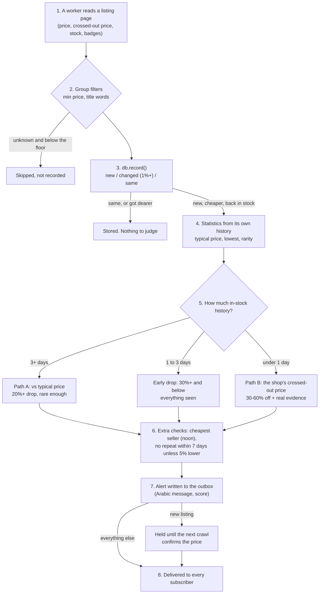

# A product's life: from first sighting to a Telegram alert

This document follows one product through the whole system, step by step, with real cases from the live
database (26 to 27 October 2026) and worked examples you can recompute by hand. The rules themselves are in
[GUIDE.md](GUIDE.md) (Algorithms 4 and 5); the code is `db.record()`, `pricing.compute_stats()`,
`pricing.evaluate()` and `alerts.py`. All prices below are in EGP (the database stores piastres, x100);
times are Cairo time unless marked UTC.

The last section answers a question from 27 October: **why only noon sends new-listing alerts so far**.



## 1. The product is seen on a listing page

Workers never open product pages. Every fact comes from the cards on category pages (24 per page on
Amazon, 50 on noon, 40 on Jumia), one crawl of each slice every 10 minutes to 9 hours depending on the
group and how busy the slice is. From each card the shop adapter builds a `Listing`:

| Field | Amazon | noon | Jumia |
| --- | --- | --- | --- |
| Key (`sku`) | ASIN, e.g. `B0BS1PRC4L` | product + seller, e.g. `N70407561V@iq` | Jumia SKU, e.g. `LG178EA3AHODVNAFAMZ` |
| Price | featured offer | sale price, else price | product price |
| Crossed-out price | "Was:" (Amazon's own recent price, kind `was`) or "List:" (RRP, kind `list`) | seller-set (kind `list`) | seller-set (kind `list`) |
| Stock left | "Only 3 left in stock" | "Only 3 left" | "1 item left" |
| Badges | limited time deal | Deal, Mega Deal, lowest price in 30 days / a year, selling out fast, bestseller | none |

## 2. The group filters decide whether it is recorded at all

Each slice belongs to a watch group (TVs, Phones...). A product the database has never seen is only
recorded if it passes the group's filters:

| Check | Example | Result |
| --- | --- | --- |
| Has a price, at or above `min_price` | A 1,200 EGP HDMI cable on a TVs page (TVs `min_price` 3,000): Amazon shows sponsored cards that ignore the price filter | skipped |
| Title contains one of `require_words` (only groups that set them) | Gaming consoles requires "console", "ps5", "nintendo switch"...: "Sony PlayStation 5 Slim Console Digital Edition" | recorded |
| Title contains none of `exclude_words` | "Sony PS5 Slim & Pro Blu-ray Disc Drive for Digital Edition" contains "disc drive" | skipped (it was recorded once before that word was added, then removed by hand) |
| "console" in the title wins over exclusions, unless it is "... for ... console" | "PS5 Console Bundle with Disc Drive" | recorded (a real console) |

A product that is already known is always updated, even if it now fails a filter (its price history
must not get gaps).

## 3. Recording: new, changed or same

`db.record()` compares the card with the stored product:

| Situation | `products` row | `price_history` row | Status |
| --- | --- | --- | --- |
| Never seen | created, `first_seen_at` = now | first row | `new` |
| Price moved 1% or more, or stock changed | price, `last_change_at` updated | new row | `changed` |
| Only the crossed-out price moved 1% or more | crossed-out price updated | new row repeating the stored price | `same` |
| Moved less than 1% | only `last_seen_at` (the stored price stays) | none | `same` |

History is a **step function**: each row's price holds until the next row. A product checked 70 times a
day at a steady price costs one row in total.

**Why the 1% noise rule exists (real case).** Before it was added (26 October, morning), FX-linked Amazon
listings drifted by one pound per crawl and each drift became a row. The Vivo Y05 phone (`B0H2DQ56N6`)
got 35 rows in 11 hours: 9,682, 9,681, 9,680 ... 9,645. Today the comparison is always against the
*stored* price, so a slow creep is recorded once it adds up to 1% (9,682 → 9,585 would be the next row),
and ordinary jitter is never a "change".

**A real product with real moves.** Kingston NV3 1TB SSD (`B0DBR3DZWG`, Amazon), from its history:

| Time (UTC) | Price | What happened |
| --- | --- | --- |
| 25 Oct 20:08 | 7,455 | first seen: `new` |
| 25 Oct 22:58 | 7,390 | -0.9%: under today's rule this would be ignored (it predates the rule) |
| 26 Oct 06:12 | 7,441.8 | the featured offer switched seller and back several times (7,440 to 7,487) |
| 26 Oct 14:07 | 8,031.7 | +7.5% vs the stored 7,472: `changed`, recorded, **not judged** (it got dearer) |
| 26 Oct 14:58 | 8,181.7 | +1.9%: `changed`, recorded, not judged |

## 4. When is a product judged?

Only when one of these is true *and* it is in stock:

- it is **new** (first sighting),
- it got **cheaper** than the stored price (by 1% or more),
- it came **back in stock**.

Rises, unchanged prices and out-of-stock sightings are only stored. That is why the SSD above never
produced a check on 26 October: both moves were rises.

## 5. Statistics from the product's own history

`compute_stats()` turns the history *before the current price* into numbers. Two rules make them hard to
fool: only **in-stock** time counts, and the **current price is never part of its own reference**.

| Number | Meaning |
| --- | --- |
| history days | in-stock days of data in the last 90 days, before the current price |
| typical (90 days) | **time-weighted median** of those earlier prices: the main reference |
| low / high | lowest / highest earlier in-stock price |
| share at or below | fraction of that in-stock time spent at or below today's price (0 = never this cheap) |
| previous | the price just before the current one |

**How the time-weighted median works (worked example).** A fridge had these in-stock stretches before
today:

| Price | Lasted |
| --- | --- |
| 12,000 | 10 days |
| 11,000 | 2 days |
| 13,500 | 3 days |

Sort by price and add up the time: 11,000 (2 days, running total 2), 12,000 (10, total 12), 13,500 (3,
total 15). Half of 15 days is 7.5; the running total first reaches 7.5 at **12,000**, so the typical price
is 12,000. A plain average (12,100) or "the price before" (13,500) would both be easier to game.

**Share at or below (same fridge).** If today's price is 11,000, it was at 11,000 or less for 2 of 15 days:
13%. At 10,500 it would be 0% (never this cheap).

## 6. The decision, and how the discount is calculated

The discount is always

```text
drop = 1 - price_now / reference
```

What changes is the **reference**, chosen by how much in-stock history the product has.

### Path A: 3 days or more of history (the trustworthy one)

Reference = typical (90-day time-weighted median). The shop's crossed-out price is ignored.

| Kind | Rule (defaults) |
| --- | --- |
| Possible price error 🚨 | drop 60% or more |
| Real price drop 🔥 | drop 20% or more (`min_drop`; a group may set its own) |
| All-time low 📉 | below every earlier price, drop 15% or more, and 14+ days of history |
| ...and for all three | the product spent at most 15% of its time at or below this price (rarity) |

Confidence is **high** with 14+ days of history and a rarity share of 5% or less, otherwise **medium**.

| Example | Numbers | Result |
| --- | --- | --- |
| TV at 32,000 for 50 days, 30,000 for 10 days, now 19,999 | typical 32,000; drop 1 - 19,999/32,000 = 37.5%; never this cheap (share 0) | 🔥 real price drop, high confidence (60 days) |
| Fridge at 10,000 for 60 days, 7,000 for 6 days last month, now 7,500 | typical 10,000; drop 25%; share at or below 7,500 = 6/66 = 9% | 🔥 real price drop, medium (share above 5%) |
| Same fridge, but the 7,000 lasted 20 days | share 20/80 = 25% > 15% | no alert: 7,500 is a price it often sits at |
| Blender alternating 5 days at 5,000 and 2 days at 3,400 for a month, now 3,400 | typical 5,000; drop 32%; but share at or below = 29% | no alert: its regular promo |
| Same blender now 2,900 | drop 42%, share 0 | 🔥 real price drop |
| The classic fake: a TV at 1,000 for 60 days, raised to 2,000 for 3 days, "50% off" back to 1,000 | typical = 1,000 (60 days outweigh 3); drop 0% | no alert (an automated test checks this case) |
| Headphones at 4,000 for 20 days, now 3,300 | drop 17.5%: under 20%, but below every earlier price, 15%+ and 14+ days | 📉 all-time low |
| Laptop at 40,000 for 30 days, now 14,000 | drop 65% | 🚨 possible price error ("may be cancelled or corrected") |

### Early drop: 1 to 3 days of history

Reference = typical, like Path A, but the bar is higher because the history is thin: the drop must be
**30% or more** and the price must be **below every price seen**. Confidence is always low, and the
message says the history is short. Since 27 October early drops are **sent at once** (no hold).

| Example | Numbers | Result |
| --- | --- | --- |
| Air fryer at 5,220 for 2 days, now 3,500 | drop 33%, new low | ⏳ early drop, sent at once |
| Same air fryer now 3,977 | drop 24% < 30% | no alert (would be a real drop after day 3 if it is still there) |
| Phone at 9,000 for 1.5 days and 7,000 for half a day, now 6,000 | typical 9,000 (1.5 of 2 days); drop 33%, below 7,000 | ⏳ early drop |

### Path B: less than 1 day of history (a new listing)

We have no reference of our own, so the shop's crossed-out price is used, but it must be backed by
evidence, because shops inflate it.

1. A crossed-out price at least **30%** above today's price.
2. Not **60% or more** off a `list` price (an RRP the seller typed in); a real Amazon "Was:" price may go further.
3. At least **one real signal**: a deal badge (Amazon limited time deal, noon Deal / Mega Deal), noon's
   "lowest price in a year", an Amazon "Was:" price, or "3 or fewer left" on noon. (Low stock does not
   count on Amazon and Jumia: 45% of their cards say it. noon's "lowest in 30 days" is on 19% of its
   catalogue, so it does not count either.)
4. During a slice's **first crawl**, when everything looks new, **two** signals are needed.

Confidence is low, and the alert is **held** until the next crawl sees the same price (section 8).

Real cases (current rules):

| Product (shop) | Price vs crossed-out | Evidence | Result |
| --- | --- | --- | --- |
| Liberty 5 by Anker earbuds, seller Original Stores (noon) | 3,148 vs 4,999: 37% | "lowest price in a year" | 🆕 sent (alert 129), score 29 |
| AeroClip by Anker (noon) | 4,999 vs 9,799: 49% | "lowest price in a year" | 🆕 sent (alert 128), score 38 |
| FreeBuds SE 2, seller Elhamed Store (noon) | 1,130 vs 2,200: 49% | 1 left (noon) | 🆕 sent (alert 124), score 38 |
| Nespresso Inissia (Amazon) | 8,999 vs 19,998: 55% | Limited time deal | 🆕 sent (alert 25) |
| Tank hand blender (Amazon) | 1,758 vs 2,707: 35% | none | no alert |
| Samsung 55" Crystal UHD (Jumia) | 20,999 vs 29,999: 30% | none (Jumia has no badges; low stock doesn't count) | no alert |
| Anker K20i earbuds (Jumia) | 899 vs 3,000: 70% | n/a | no alert: 60%+ off a seller's list price is almost always fake |
| Wave Buds 2 earbuds (noon) | 5,240 vs 9,999: 48% | "lowest in 30 days" only | no alert (that badge is on 19% of noon) |

**About the first day's alerts.** 47 of the 105 new-listing alerts so far were sent in the first ten
hours (25 to 26 October morning), under looser rules: for example a RAM kit at 1,900 "77% off" 8,268 with
only "lowest in 30 days". The stricter rules above shipped on 26 October at 10:50; every alert since then
passes them.

## 7. Extra checks before an alert is written

| Check | Rule | Example |
| --- | --- | --- |
| Cheapest seller (noon) | no alert while another seller has the same item **cheaper and in stock**, counting only offers seen in the last 24 hours | Real item `N70407561V` (Play 20A phone) has 5 sellers: iQ 7,842, Dubai Phone 7,900, Best Electronic 8,149, Dr.Mobile 8,362, noon 8,999. If Dr.Mobile dropped to 7,950 it would be no deal: iQ is cheaper. If iQ vanished from the pages for a day, its 7,842 would stop counting |
| No repeats | the same product is not alerted again within **7 days** unless the price is **5% below** the last alert | alerted at 13,500 → 12,900 on day 2 is not enough (needs 12,825 or less) → 12,800 alerts again |
| Cancelled alerts don't count | a held alert that was cancelled does not block the next one | |

## 8. Writing, holding and delivering the alert

**The score (0 to 100)**, for ranking:

```text
score = (drop % + 10 if all-time low - half the rarity share in %
         + 5 if 5 or fewer left + 5 for a deal badge + 5 for a "lowest price" badge)
        x 1.0 (high) / 0.85 (medium) / 0.7 (low confidence)
```

| Alert | Calculation | Score |
| --- | --- | --- |
| 129 Liberty 5 (new listing) | (37.0 + 5 lowest badge) x 0.7 = 29.4 | 29 |
| 128 AeroClip | (49.0 + 5) x 0.7 = 37.8 | 38 |
| 124 FreeBuds SE 2 | (48.6 + 5 for 1 left) x 0.7 = 37.5 | 38 |
| TV 32,000 → 19,999 (Path A, high) | 37.5 + 10 all-time low - 0 = 47.5 x 1.0 | 48 |
| Fridge 10,000 → 7,500, share 9% (medium) | (25 - 4.5) x 0.85 = 17.4 | 17 |

**The outbox.** The alert row (with the final Arabic text) is written in the same database transaction as
the price, so a crash or a Telegram outage never loses it. This is alert 129 as it went out:

```text
🆕 منتج جديد بخصم كبير · خصم 37%
Liberty 5 by Anker, Noise-Cancelling Wireless Earbuds, ...
ℹ️ الماركة: Soundcore · ★ 4.2 (5 تقييم)

💰 السعر الآن: 3,149 جنيه (السعر المشطوب على الموقع 4,999 جنيه)

🧠 ليه ده عرض حقيقي؟
• المنتج جديد علينا (نتابعه منذ أقل من يوم): الخصم معلن من الموقع ولم نتحقق منه من سجل أسعارنا
• الدليل الداعم: الموقع: أقل سعر خلال سنة
• الثقة منخفضة: نعتمد على كلام الموقع أو على سجل قصير

⚠️ قبل ما تشتري
• البائع: Original Stores (ليس الموقع نفسه: راجع تقييم البائع وسياسة الإرجاع)
• أرخص بائع آخر لنفس المنتج: 3,275 جنيه
• افتح صفحة المنتج وتأكد من السعر والحالة (جديد/مستعمل) قبل الدفع

🔖 سماعات · نون مصر · الثقة: منخفضة · النقاط: 29/100
```

**Holding (new listings only).** A new-listing alert waits for the product's next crawl:

| Next sighting | Result | Real case |
| --- | --- | --- |
| Same price or cheaper | released and sent | alert 129: created 23:38, slice crawled again, sent 00:01 (23 min) |
| Price went back up | cancelled, never sent | none yet: all 85 held alerts on 26 October were confirmed |
| Nobody recrawls it in time (3 x the group interval + 10 min, at least 90 min) | sent anyway | the Ocean freezer (Refrigerators, 20-minute group) waited 90 minutes |

Early drops (since 27 October) and Path A alerts are never held.

**Delivery.** Every 3 seconds the sender gives each new alert one `deliveries` row per active subscriber
(alert 129: 6 rows, 6 sent), then sends them one per second. A failure is retried after 30 s, 1, 2, 4
minutes... up to an hour, at most 10 times; someone who blocked the bot is marked `blocked` and skipped.
System warnings and the daily report go only to the owner and the helper admins.

## 9. One product, start to finish (a worked timeline)

A Samsung 55" TV in the TVs group (`min_price` 3,000, `min_drop` 20%, crawled about every 20 minutes),
with a crossed-out price of 25,000 throughout.

| When | Seen at | Recorded? | Judged? | History (in stock) | Decision |
| --- | --- | --- | --- | --- | --- |
| Day 0 10:00 | 20,000 | `new`, row 1 | yes (new) | none | Path B: 1 - 20,000/25,000 = 20% < 30%: no alert |
| Day 0, every 20 min | 20,000 | `same` (only `last_seen_at`) | no | | |
| Day 0 18:00 | 19,900 | `same`: -0.5% is noise, stored price stays 20,000 | no | | |
| Day 1 02:00 | 19,700 | `changed` (-1.5% vs the stored 20,000), row 2 | yes (cheaper) | 20,000 for 16 h = 0.67 days | still Path B: 21% < 30%: no alert |
| Day 2 12:00 | 15,500 | `changed`, row 3 | yes | 20,000 16 h + 19,700 34 h = 2.1 days | early path: typical = 19,700 (34 of 50 h); drop 21% < 30%: no alert |
| Day 3 12:00 | 20,000 | `changed`, row 4 | no (dearer) | | |
| Day 6 12:00 | 13,500 | `changed`, row 5 | yes | 6.1 days: 15,500 24 h, 19,700 34 h, 20,000 88 h | Path A: typical 20,000 (88 of 146 h); drop 32.5%; share 0; below every earlier price → 🔥 real price drop (also an all-time low), medium (6 days < 14). Score (32.5 + 10) x 0.85 = 36. Sent at once to everyone |
| Day 7 12:00 | 12,900 | `changed` | yes | | a deal again (36% below), but only 4.4% below the last alert (13,500); needs 12,825 within 7 days: no repeat |
| Day 8 12:00 | 12,800 | `changed` | yes | 8.1 days | typical now 19,700 (sorted 12,900 / 13,500 / 15,500 / 19,700: running total reaches half of 194 h at 19,700); drop 35%; 5.2% below the last alert → 🔥 sent again, score (35 + 10) x 0.85 = 38 |
| Day 9 | out of stock | `changed` (stock) | no | | |
| Day 10 | 12,800, back in stock | `changed` | yes (back in stock) | | same price as the last alert, within 7 days: no repeat |

## 10. Why only noon sends new-listing alerts (so far)

Two reasons, measured on 27 October over every product first seen in the previous 24 hours.

**First, the system is young, so the new-listing path is the only one open.** Path A needs 3 days of a
product's own in-stock history and early drops need 1 day. Amazon and noon have been tracked since
25 October in the evening, Jumia since 26 October at 21:08. Until those ages are reached, the only
possible alert is a new listing, which relies on the shop's own evidence:

| Shop | Early drops possible from | Real drops (Path A) from | All-time lows (14 days) from |
| --- | --- | --- | --- |
| Amazon, noon | 26 October, late evening | 28 October, late evening | 8 November |
| Jumia | 27 October, about 21:00 | 29 October, about 21:00 | 9 November |

(Each product counts from its own first sighting, so products added later, such as the headphones the
planner fix found on 26 October, start later.)

**Second, only noon gives the evidence a new listing needs.** Where each new product stopped:

| Step | Amazon (806 new) | noon (5,227 new) | Jumia (13,437 new) |
| --- | --- | --- | --- |
| No crossed-out price | 729 (90%) | 4,533 | 3,280 |
| Claimed discount under 30% | 70 | 519 | 7,894 |
| Claim of 60%+ off a seller's list price (rejected as fake) | 0 | 14 | 150 |
| 30 to 60% claimed but **no evidence** | 7 | 114 | 2,113 |
| **Passes (alert)** | **0** | **47** | **0** |
| Evidence-type signals on those new products | 7 limited deals | 240 "lowest in a year", 14 Mega Deal, 6 Deal, 324 "3 or fewer left" | none (8,406 say "3 or fewer left", which doesn't count) |

- **Amazon** shows a crossed-out price on only about 10% of cards, and almost never with a limited-time-deal
  badge or a "Was:" price; it also adds few new products a day (806). Its 6 new-listing alerts were all on
  the first evening (Nespresso machines with limited-time deals).
- **Jumia** shows no badges on category pages at all, and "3 or fewer left" is on 63% of its cards, so it
  can't count. By design a Jumia new listing never alerts. 2,113 Jumia products claim 30 to 60% off, which
  shows why: those claims are routine there.
- **noon** has the badges that make a claim believable ("lowest price in a year", Deal, Mega Deal) and its
  "only 1 left" is meaningful.

This is intended: a shop's own discount claim is the weakest evidence, and Amazon and Jumia give nothing
to back it. Their alerts will come from our own history: early drops from the dates above, real drops two
days later. Those are the alerts worth acting on.

## Where this lives in the code

| Step | Code |
| --- | --- |
| 1 Reading a card | `sites/amazon_eg.py` `_parse_card`, `sites/noon_eg.py` `_parse_hit`, `sites/jumia_eg.py` `_parse_product`, `sites/btech_eg.py` `_parse_item`, `sites/dream2000_eg.py` `product_listings`, `sites/cairosales_eg.py` `_parse_card`, `sites/twob_eg.py` `_parse_item`, `sites/carrefour_eg.py` `_parse_card` |
| 2 Group filters | `coordinator.py` page handler (`unwanted`), `config.Watch.accepts` |
| 3 Recording | `db.record()`, `db.PRICE_NOISE` |
| 4 When judged | `coordinator.py` page handler (`dropped`) |
| 5 Statistics | `pricing.compute_stats()`, `weighted_median()` |
| 6 Decision | `pricing.evaluate()` (`STRONG_SIGNALS`, `LOW_STOCK_EVERYWHERE`) |
| 7 Extra checks | `alerts.check_product()`: `db.best_other_offer()`, `_recently_alerted()` |
| 8 Score, message, hold, delivery | `pricing.evaluate()` (score), `alerts.format_deal()`, `AlertSender.confirm / fan_out / deliver` |
| Thresholds | `[alerts]` in the config, `config.AlertRules` |
